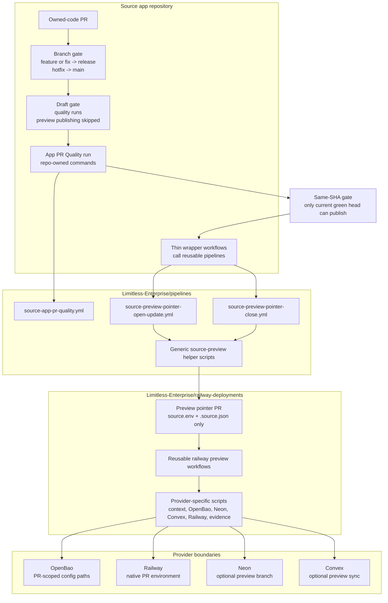
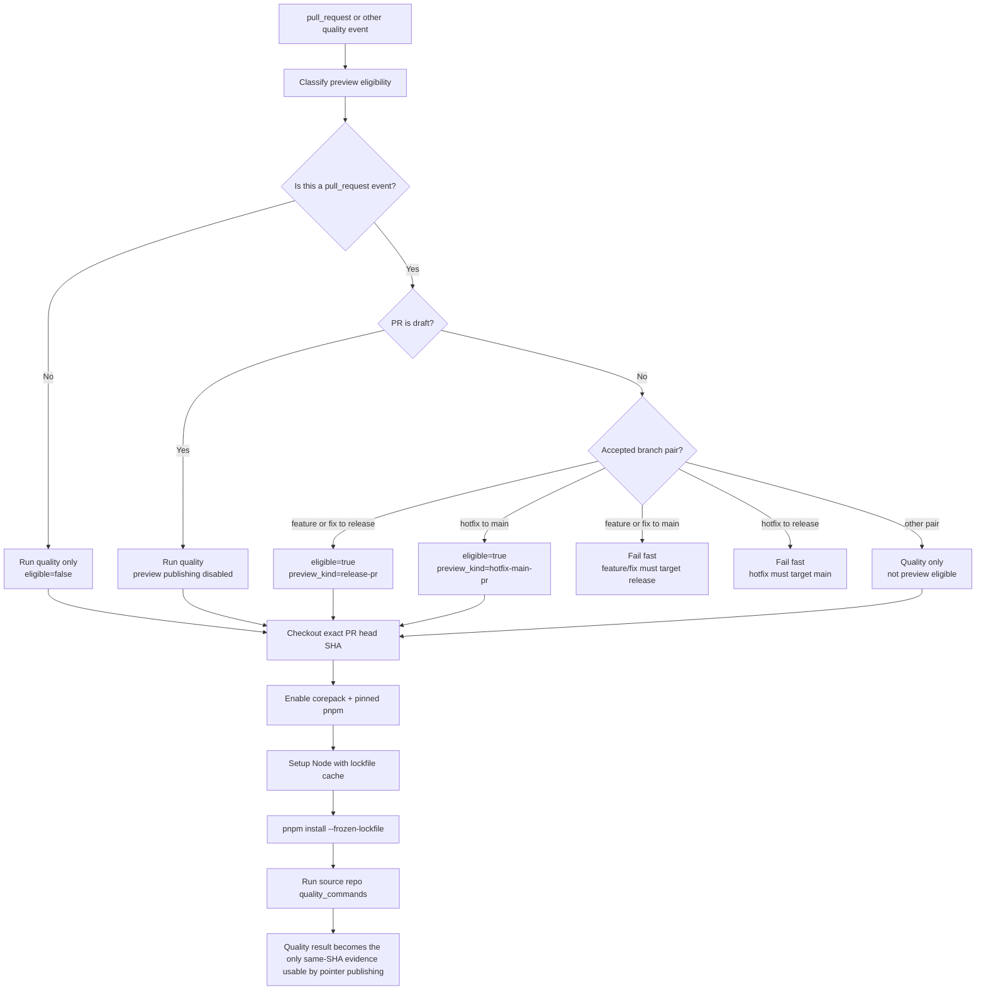
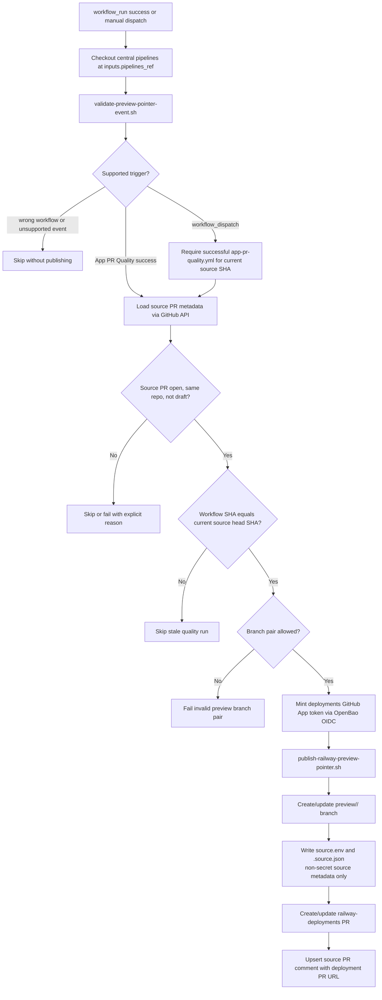
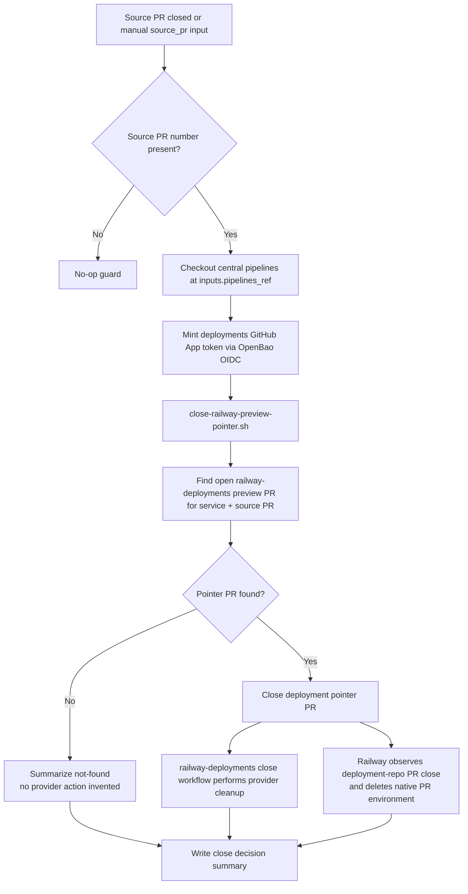
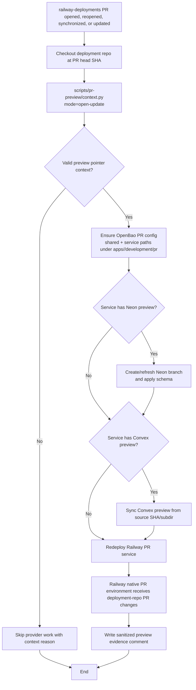
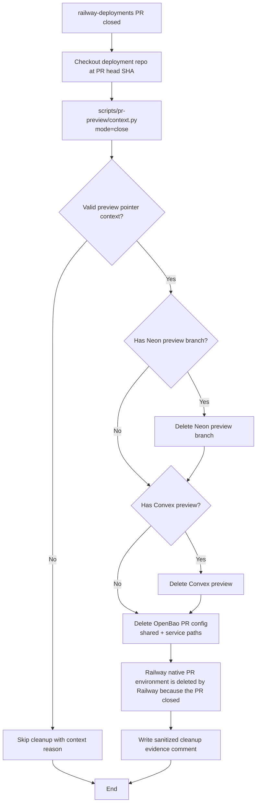
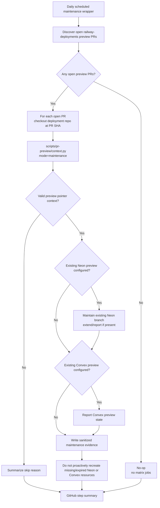

# PR preview shared pipelines

This repository owns the reusable GitHub Actions contracts and generic helper scripts for Limitless owned-code Railway PR previews.

## Contents

- [Central vs local split](#central-vs-local-split)
- [Accepted behavior preserved](#accepted-behavior-preserved)
- [End-to-end authority boundaries](#end-to-end-authority-boundaries)
- [Source app PR quality](#source-app-pr-quality)
- [Source preview pointer open/update](#source-preview-pointer-openupdate)
- [Source preview pointer close](#source-preview-pointer-close)
- [Railway preview open/update orchestration](#railway-preview-openupdate-orchestration)
- [Railway preview close cleanup](#railway-preview-close-cleanup)
- [Daily preview maintenance](#daily-preview-maintenance)
- [Safety notes](#safety-notes)

## Central vs local split

Central `pipelines` owns:

- reusable source-app quality workflow scaffolding and accepted branch-pair classification;
- reusable source preview pointer open/update and close workflow contracts;
- generic source-pointer helper scripts for same-SHA quality gating, OpenBao-backed Railway deploy-bot token minting, deployment-pointer PR upsert/close, and source PR comments;
- reusable `railway-deployments` workflow contracts that call provider-specific scripts from the deployment repository.

Consuming source app repositories still own:

- triggers, concurrency, and local permissions;
- repo-specific quality commands and any repo-specific quality jobs;
- source subdirectory and service identity inputs;
- thin wrapper workflows that call the central reusable workflow at the reviewed `pipelines` ref.

`Limitless-Enterprise/railway-deployments` still owns:

- Railway service roots and source pointer files;
- provider-specific OpenBao, Neon, Convex, Railway redeploy, cleanup, maintenance, context parsing, and evidence scripts;
- deployment-repo documentation for provider behavior and required setup;
- control-plane authority over preview PRs and temporary provider resources.

## Accepted behavior preserved

- `feature/*` and `fix/*` PRs must target `release/*` to publish previews.
- `hotfix/*` PRs must target `main` to publish previews.
- Draft PRs run quality but do not publish pointers until `ready_for_review` and a green quality run.
- Preview pointer publishing requires a successful `app-pr-quality.yml` run for the current source PR head SHA.
- Source app workflows write only non-secret source pointers and never deploy directly to Railway.
- Railway PR environment creation/deletion remains Railway-native from `railway-deployments` PRs.
- OpenBao PR config uses mount `platform-secrets` and `apps/<railway-project-name>/development/pr/...` key paths.
- Maintenance does not proactively recreate expired or missing Neon/Convex resources.

Consumers currently reference this task branch while the central PR is under review. After the central PR lands, follow-up consumer commits should move `pipelines_ref` and `uses` refs to the reviewed stable ref chosen by maintainers.

## End-to-end authority boundaries

This high-level flow shows the authority split from a source app PR to the deployment control plane. The source repository can ask for a preview only after its own quality gate is green for the current SHA; central `pipelines` hosts reusable workflow logic and generic helpers; `railway-deployments` owns the provider-facing PR and provider lifecycle.

## Source app PR quality

Reusable workflow: `.github/workflows/source-app-pr-quality.yml`

Purpose: centralize the preview eligibility classifier and Node/pnpm quality scaffold while leaving actual lint/typecheck/build commands in the source app repository.

Key gates:

- Branch eligibility is explicit and fails invalid release/hotfix pairings.
- Draft PRs are allowed to run quality so authors get feedback, but they are not eligible for preview publishing.
- The checkout uses the PR head SHA, not a moving branch tip during the job.
- The source app owns `quality_commands`; central `pipelines` does not assume product-specific checks.

## Source preview pointer open/update

Reusable workflow: `.github/workflows/source-preview-pointer-open-update.yml`

Purpose: after a source PR has a current green App PR Quality run, publish or update a non-secret deployment pointer PR in `railway-deployments`.

Authority boundaries:

- The source app thin wrapper triggers this reusable workflow but does not write directly to provider systems.
- OpenBao is used only to mint the GitHub App token for `railway-deployments`; token values are never documented or written to the repo.
- The deployment pointer is intentionally limited to source repo, PR, SHA, ref, subdir, base, URL, and preview kind metadata.
- The same-SHA quality gate prevents an older green quality run from publishing a preview for a newer unverified commit.

## Source preview pointer close

Reusable workflow: `.github/workflows/source-preview-pointer-close.yml`

Purpose: when the source PR closes, ask `railway-deployments` to close the corresponding deployment pointer PR so Railway-native PR environment cleanup and provider cleanup can run from the deployment repo.

Key gates:

- Source repositories do not delete Railway, Neon, Convex, or OpenBao resources directly.
- The source close workflow only closes the deployment control-plane PR after minting the deployment-repo token.
- Missing pointer PRs are reported as not found; the workflow does not fabricate provider cleanup evidence.

## Railway preview open/update orchestration

Reusable workflow: `.github/workflows/railway-preview-open-update.yml`

Purpose: run inside `railway-deployments` on a deployment pointer PR and prepare/refresh the temporary preview environment boundaries.

Authority boundaries:

- `railway-deployments` is the only repository in this flow that calls provider-specific scripts.
- OpenBao path patching happens in the deployment repo under PR-scoped shared/service paths; the workflow references path names, not secret values.
- Railway environment creation remains native to Railway PR environments tied to the deployment repo PR.
- Neon and Convex work is conditional on service context discovered by the deployment repo.

## Railway preview close cleanup

Reusable workflow: `.github/workflows/railway-preview-close.yml`

Purpose: run inside `railway-deployments` when the deployment pointer PR closes and clean up provider-side preview resources owned by that pointer.

Key cleanup properties:

- Cleanup is keyed by deployment PR context and source PR/service metadata resolved by the deployment repo.
- Provider deletion scripts receive only the path names and identifiers they need; no secret material belongs in docs or committed pointer files.
- Railway PR environment deletion stays native to Railway, while provider-side cleanup is explicitly handled by deployment scripts.

## Daily preview maintenance

Reusable workflow: `.github/workflows/railway-preview-maintenance.yml`

Purpose: run daily from `railway-deployments`, inspect open deployment preview PRs, maintain resources that already exist, and report evidence without proactively recreating expired or missing provider resources.

Maintenance rules:

- The job works from open deployment PRs, not from source repositories directly.
- The matrix checks each deployment PR at the recorded PR head SHA.
- Maintenance can extend/report existing resources, but it must not create brand-new Neon or Convex resources just because a daily job found them missing.
- Evidence comments and step summaries must remain sanitized and must not include secret values.

## Safety notes

- Do not commit provider credentials, tokens, or environment-specific secret values to this repository.
- `source.env` in deployment pointer PRs carries source metadata only; it is not a secret handoff file.
- OpenBao examples should name mounts and paths, not values. The expected PR config path shape is `platform-secrets/apps/<railway-project-name>/development/pr/...`.
- Source app repositories keep thin workflow wrappers: they call the central reusable workflow and pass repo/service inputs, but they do not own deployment control-plane behavior.
- `railway-deployments` remains the owner for Railway service roots, `.source.json`, `source.env`, provider scripts, and preview evidence comments.
